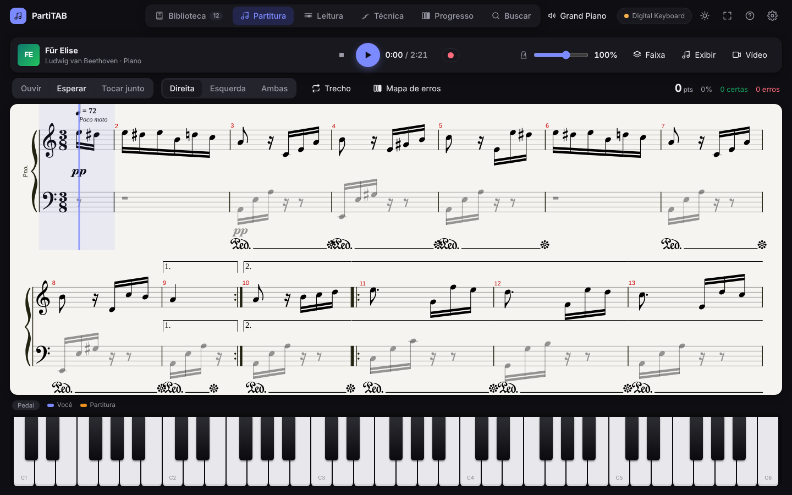
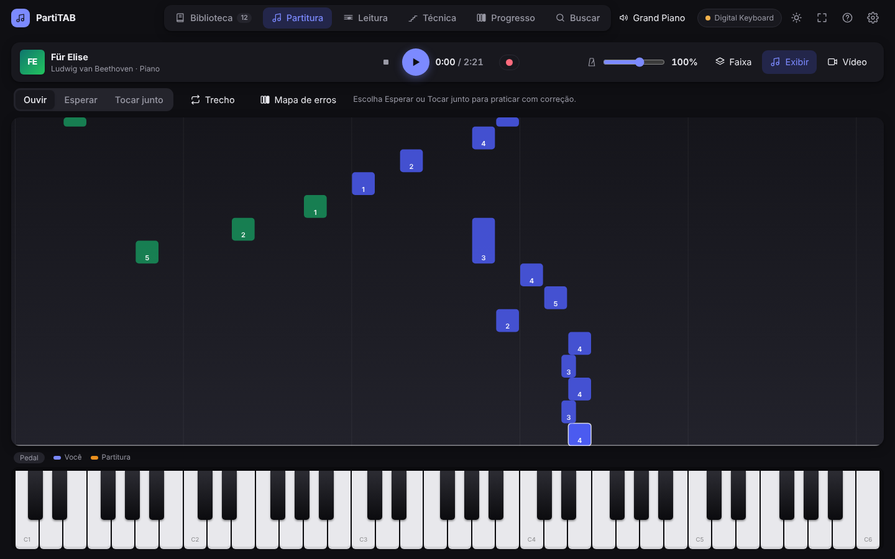
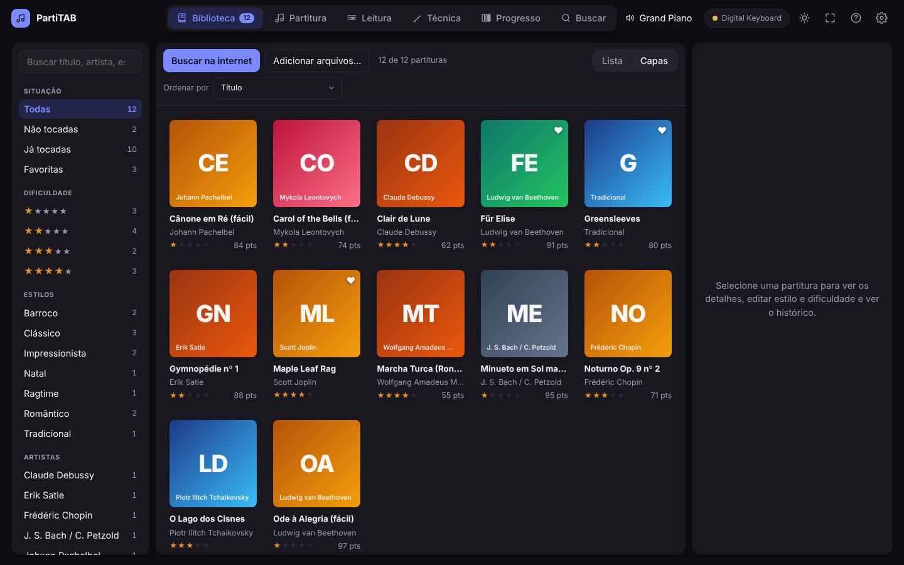
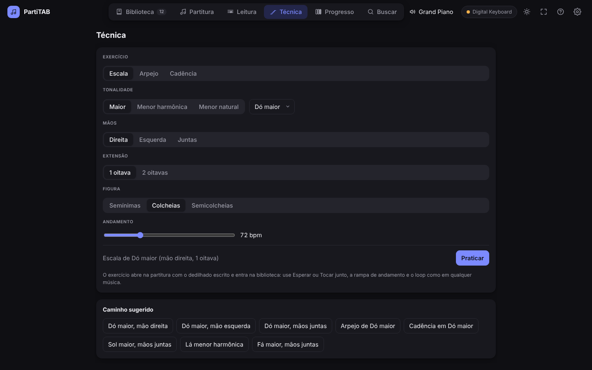
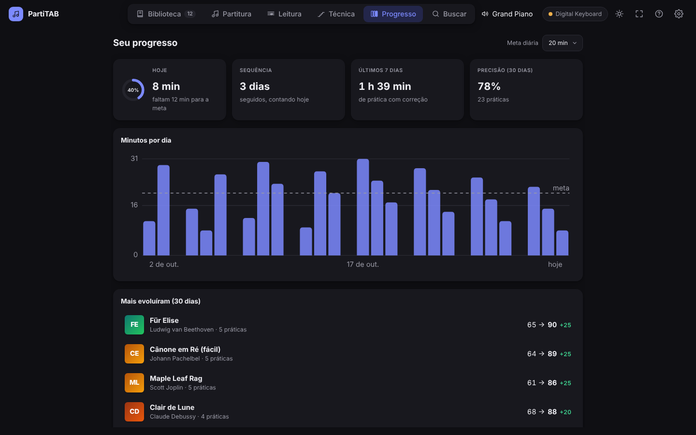

  

<h1 align="center">PartiTAB</h1>

  <b>Aprenda piano com partitura de verdade, o seu teclado e correção nota a nota.</b> 
  Gratuito, em português, para Windows.

  
  
  

  <a href="https://github.com/JeeAreOh/PartiTAB/releases/latest"><b>⬇ Baixar a versão mais recente</b></a>

O PartiTAB mostra a partitura, toca a música e acompanha o que você toca num teclado ligado ao computador por USB. No modo **Esperar**, o cursor só anda quando você acerta as notas; no **Tocar junto**, a música segue no andamento e cada nota é avaliada (no tempo, adiantada, atrasada, errada). Abre arquivos **Guitar Pro, MusicXML e MIDI**, transforma tabs de banda em arranjos de piano por nível e tem exercícios de técnica, treino de leitura e acompanhamento do progresso.

Foi feito com o Yamaha PSR-E463 e deve funcionar com qualquer teclado ou piano digital que tenha **USB-MIDI**.

## Funcionalidades

**Praticar músicas**

- **Três modos:** Ouvir, Esperar (o cursor espera a nota certa) e Tocar junto (no andamento, com nota de 0 a 100). Mão direita, esquerda ou as duas; a outra mão e a banda são tocadas pelo app.
- **Trechos em loop** com rampa de andamento: começa em 60% e sobe a cada volta sem erro.
- **Seções** (Introdução, Refrão, "parte difícil"…) salvas com a música, e as que já vêm no arquivo.
- **Mapa de erros:** mostra os compassos onde você mais erra e treina só eles.
- **Notas caindo**, no estilo dos jogos de piano, e **dedilhado** sugerido (1 = polegar … 5 = mínimo).
- **Tocar junto com um vídeo do YouTube**, com a partitura sincronizada à gravação original.
- **Gravar** o que você toca, ouvir de volta e exportar em MIDI.

**Repertório**

- Abre **Guitar Pro** (`.gp3` a `.gp`), **MusicXML** (`.musicxml`, `.mxl`), **Capella** e **MIDI** (`.mid`, convertido em partitura, com cada instrumento numa faixa).
- **Arranjo para piano** de qualquer partitura, inclusive tabs de banda: nível 1 (melodia), 2 (melodia + baixo) e 3 (melodia + acordes), com opção de tom fácil.
- **Busca integrada:** sites de MIDI para piano, MuseScore, IMSLP, Cifra Club e outros abrem dentro do app, e o que você baixa entra direto na biblioteca.
- **63 peças de piano em domínio público** já vêm na biblioteca (Bach, Mozart, Beethoven, Chopin, Debussy, Satie, Joplin…), várias com versão fácil.

**Estudo**

- **Técnica:** escalas, arpejos e cadências nas 24 tonalidades, com o dedilhado tradicional escrito.
- **Leitura:** cartões com notas na pauta (clave de sol e de fá), com repetição espaçada nas notas que você mais erra.
- **Progresso:** minutos por dia, meta diária, dias seguidos de prática e as músicas que mais evoluíram.

**Som e teclado**

- Piano gerado no computador com baixo atraso, ou **som pelo próprio teclado** (a banda e o metrônomo também saem por ele).
- Troca de timbre, volume, reverb, sensibilidade ao toque e SoundFonts gratuitos para baixar com um clique.
- Calibração do atraso, tema escuro e claro, tela cheia em qualquer monitor, backup da biblioteca e **Ajuda** completa dentro do app (<kbd>F1</kbd>).

<table>
  <tr>
    <td></td>
    <td></td>
  </tr>
  <tr>
    <td align="center">Notas caindo, com dedilhado</td>
    <td align="center">Biblioteca</td>
  </tr>
  <tr>
    <td></td>
    <td></td>
  </tr>
  <tr>
    <td align="center">Escalas, arpejos e cadências</td>
    <td align="center">Progresso</td>
  </tr>
</table>

## Instalação

1. Baixe o `PartiTAB_<versão>_x64-setup.exe` na [página de versões](https://github.com/JeeAreOh/PartiTAB/releases/latest).
2. Abra o instalador. Como ele ainda não tem assinatura digital, o Windows pode mostrar **"O Windows protegeu o computador"**: clique em **Mais informações → Executar assim mesmo**.
3. O app verifica sozinho se há versão nova e se atualiza pelo botão **Atualizar agora**, mantendo a biblioteca e os ajustes.

**Requisitos:** Windows 10 ou 11 (64 bits). Para praticar com correção, um teclado ou piano digital com USB-MIDI; sem teclado, dá para ouvir as músicas e tocar no teclado virtual com o mouse.

## Primeiros passos

1. Ligue o teclado ao computador pela porta USB (no PSR-E463, **USB TO HOST**).
2. No PartiTAB, abra a engrenagem (**Ajustes**) → **Teclado**, escolha a porta e clique em **Conectar**.
3. Na **Biblioteca**, abra uma música (Für Elise, por exemplo) e toque <kbd>Espaço</kbd> para ouvir.
4. Escolha **Esperar** e a mão **Direita** e toque junto: o cursor anda quando você acerta.

A **Ajuda** (botão **?** ou <kbd>F1</kbd>) explica cada função e tem uma seção de problemas comuns.

## Perguntas frequentes

**Ouço as notas dobradas, como eco.** O teclado e o computador estão soando juntos. O app desliga o som interno do teclado ao conectar; se o seu teclado não aceitar, desligue o *Local Control* no painel dele (no PSR-E463, função 050 → OFF) ou ligue **Ajustes → Teclado → Som pelo teclado**.

**Os nomes das oitavas estão diferentes do meu livro.** O app usa a convenção da Yamaha (dó central = C3). Alguns livros usam a científica, em que o mesmo dó se chama C4.

**De onde vêm as partituras?** Dos seus arquivos, das 63 peças em domínio público que acompanham o app e dos sites da aba **Buscar**, que abrem dentro do app como num navegador. O PartiTAB não baixa nada dos sites por conta própria: só importa o que você baixar, respeitando as regras de cada site.

**Meus dados vão para algum lugar?** Não. Biblioteca, práticas e ajustes ficam só no seu computador. O app acessa a internet apenas quando você usa a busca, procura capas de álbum, baixa SoundFonts, abre um vídeo do YouTube ou verifica atualizações.

**Funciona em Mac ou Linux?** Por enquanto, não. O app é feito com Tauri, que existe para esses sistemas, mas só a versão para Windows é compilada e testada.

## Contribuir

Encontrou um erro ou tem uma ideia? [Abra uma issue](https://github.com/JeeAreOh/PartiTAB/issues/new/choose). Para compilar e entender o código, veja o [guia de desenvolvimento](docs/DESENVOLVIMENTO.md). As mudanças de cada versão estão no [histórico de versões](CHANGELOG.md).

## Licença e créditos

O PartiTAB é software livre, distribuído sob a [GNU GPL 3.0](LICENSE). Ele se apoia em projetos abertos como [alphaTab](https://alphatab.net/) (leitura e desenho da partitura), [Tauri](https://tauri.app/), [RustySynth](https://github.com/sinshu/rustysynth) e o SoundFont SONiVOX; a lista completa, com as licenças, está em [CRÉDITOS](CREDITOS.md).
