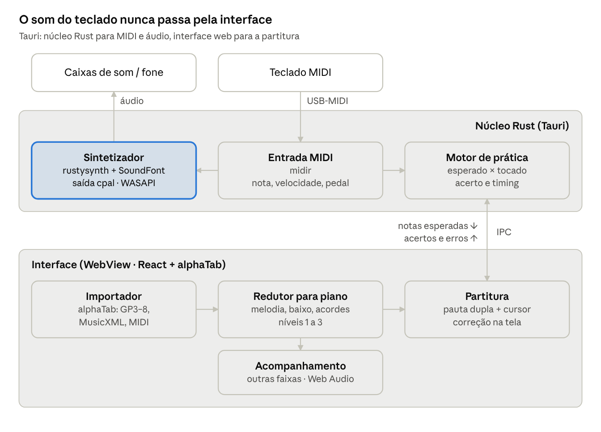

# PartiTAB — Plano do app de piano para Windows

29 out. 2026 · Gefferson Oliveira

## Veredito e premissas

Vale construir: o PSR-E463 envia MIDI pela porta USB TO HOST (cabo USB A–B comum, sem interface), então detectar notas é trivial e exato, e o próprio app gera o som de piano. O projeto vira um leitor de partitura com motor de prática e sintetizador, escopo de 3 a 5 meses em horas vagas.

- **Teste antes de codar.** [PianoBooster](https://github.com/pianobooster/PianoBooster) (GPLv3) já faz partitura rolando + espera pela nota certa + mão separada, a partir de MIDI. [Neothesia](https://github.com/PolyMeilex/Neothesia) (Rust, GPLv3) faz o estilo "blocos caindo" do Synthesia. Uma semana com os dois define o que realmente falta.

- **MIDI é premissa, não opção.** Reconhecer acordes pelo microfone é o problema técnico mais difícil do Simply Piano. Fica como fase opcional no fim, não no MVP.

- **O que não se copia com código:** o currículo didático (sequência de lições, músicas arranjadas por nível). Esse é o produto real que a mensalidade paga. O app precisa compensar com um gerador de exercícios e arranjos por dificuldade, senão vira só um player.

## Guitar Pro como acervo: funciona, com um asterisco grande

Ler o arquivo é problema resolvido; transformar guitarra em piano não é. A biblioteca [alphaTab](https://alphatab.net/) (MPL-2.0, gratuita) abre Guitar Pro 3 a 8, MusicXML e Capella, renderiza pauta dupla de piano e toca com SoundFont. O asterisco: a maioria das tabs da internet tem faixas de guitarra, baixo, bateria e às vezes voz — raramente piano.

A solução é um **redutor para piano**, o módulo que realmente diferencia o app:

1.  **Nível 1** — só a melodia (faixa de voz ou guitarra solo) na mão direita.

2.  **Nível 2** — melodia + fundamental do baixo na mão esquerda, uma nota por tempo forte.

3.  **Nível 3** — melodia + acordes simplificados (tríades em posição fechada) extraídos da guitarra base.

4.  **Ajustes automáticos** — transposição de oitava para caber nas 61 teclas do PSR-E463 (notas MIDI 36 a 96) e de tom para tonalidades com poucas alterações (Dó, Sol, Fá) nos níveis iniciais.

Isso transforma a limitação em vantagem: cada música vira 3 exercícios de dificuldade crescente, coisa que o Simply Piano faz manualmente com arranjadores.

| Fonte                                                        | Formato                         | Piano pronto?                  | Uso no app                                      |
|--------------------------------------------------------------|---------------------------------|--------------------------------|-------------------------------------------------|
| Tabs Guitar Pro (Songsterr, Ultimate Guitar etc.)            | .gp3–.gp                        | Raramente                      | Repertório popular via redutor                  |
| [OpenScore](https://openscore.cc/blog/introducing-openscore) | MusicXML, domínio público (CC0) | Sim                            | Clássicos para leitura de partitura             |
| Arquivos MIDI                                                | .mid                            | Às vezes (sem divisão de mãos) | Repertório amplo; exige separar mãos por altura |
| Arquivos MusicXML exportados do MuseScore                    | .musicxml                       | Sim                            | Arranjos de piano já feitos                     |

Tabs baixadas da internet ficam para uso pessoal; o app importa arquivos locais e não redistribui nada.

## Funcionalidades

O núcleo replica o ciclo do Simply Piano (ver, tocar, receber correção); as melhorias atacam o que ele não faz: repertório próprio, prática dirigida por erro e tocar junto com a banda.

**Núcleo (paridade com o Simply Piano)**

- Importar Guitar Pro, MusicXML e MIDI de arquivos locais.

- Partitura em pauta dupla com cursor acompanhando a música.

- **Modo espera:** a música só avança quando a nota certa é tocada.

- Mãos separadas: só direita, só esquerda ou ambas; o app toca a mão que você não está praticando.

- Correção em tempo real: nota certa, errada, adiantada ou atrasada, com pontuação por acerto e precisão de tempo.

- Metrônomo e controle de andamento de 25% a 150%.

- **Som gerado pelo app:** o teclado vira controlador; cada tecla dispara um piano amostrado no PC, respeitando velocidade (força do toque) e pedal de sustain. Ao conectar, o app desliga o som interno do teclado (Local Control Off por mensagem MIDI) e religa ao fechar.

**Melhorias**

- **Redutor para piano** em 3 níveis (seção anterior): cada tab vira três exercícios.

- **Tocar com a banda:** as demais faixas do Guitar Pro (bateria, baixo, guitarras) tocam como acompanhamento enquanto você faz a parte do piano.

- **Loop A–B com rampa de andamento:** repete compassos difíceis subindo o andamento 5% a cada execução limpa, de 60% até 100%.

- **Mapa de erros:** registra quais compassos e quais notas você mais erra e gera sessões curtas só com esses trechos.

- **Treino de leitura:** cartões de notas na pauta com tempo de resposta e repetição espaçada focada nas notas que você confunde. Opção de esconder o teclado virtual para forçar leitura pela partitura.

- **Dedilhado sugerido:** algoritmo de menor custo de movimento propõe números de dedo sobre as notas; editável.

- **Gravação:** salva sua execução em MIDI para ouvir e comparar com o original.

## Arquitetura

Tauri 2 com núcleo em Rust e interface em React + Vite — a combinação que você já domina — e o som do teclado gerado inteiramente no Rust.

arquitetura · núcleo Rust + interface web

O toque vai do midir direto ao sintetizador e às caixas; a interface só recebe o resultado para desenhar.

- **Caminho do som:** o midir entrega cada nota ao rustysynth, que renderiza pelo cpal (WASAPI). Nada passa pela WebView, onde a latência cresceria.

- **Partitura:** o alphaTab é TypeScript e roda nativo na interface; o redutor para piano opera sobre o modelo de partitura dele.

- **Motor de prática:** recebe as notas esperadas pelo IPC do Tauri e devolve acertos e timing; um atraso de poucos ms aqui afeta só o desenho, não o som.

- **Timbre único:** o mesmo arquivo SoundFont no rustysynth e no sintetizador do alphaTab, para seu toque e o acompanhamento soarem iguais.

- **Persistência:** progresso e mapa de erros em SQLite local.

| Componente             | Biblioteca                                               | Papel                                                |
|------------------------|----------------------------------------------------------|------------------------------------------------------|
| Entrada MIDI           | [midir](https://github.com/Holzhaus/midir) (MIT)         | Lê o teclado via WinMM ou WinRT                      |
| Sintetizador           | [RustySynth](https://github.com/sinshu/rustysynth) (MIT) | SoundFont em tempo real, com pedal de sustain        |
| Saída de áudio         | [cpal](https://github.com/RustAudio/cpal)                | WASAPI por padrão; ASIO opcional para menor latência |
| Partitura e importação | [alphaTab](https://alphatab.net/) (MPL-2.0)              | Guitar Pro 3–8, MusicXML, renderização e reprodução  |

**Fontes:** [alphaTab](https://alphatab.net/) · [midir](https://github.com/Holzhaus/midir) · [RustySynth](https://github.com/sinshu/rustysynth) · [cpal](https://docs.rs/crate/cpal/latest) · [PianoBooster](https://github.com/pianobooster/PianoBooster) · [Neothesia](https://github.com/PolyMeilex/Neothesia) · [OpenScore](https://openscore.cc/blog/introducing-openscore) · [Basic Pitch](https://github.com/spotify/basic-pitch)

## Roadmap

O app passa a substituir o Simply Piano no fim da fase 3, por volta da 10ª semana; o resto é ganho sobre ele. Estimativas para horas vagas, cerca de 8 h por semana.

1.  **Fase 0 — Validação (1 semana).** Usar PianoBooster e Neothesia com o teclado; confirmar que o Windows reconhece a porta MIDI; escolher um SoundFont de piano. Entregável: lista do que falta nesses apps.

2.  **Fase 1 — Piano virtual (2–3 semanas).** App Tauri que lista portas MIDI e toca som de piano a cada tecla, com velocidade e sustain. Entregável: teclado soando pelo PC. Critério para avançar: latência imperceptível tocando escalas rápidas.

3.  **Fase 2 — Leitor de partitura (3 semanas).** Importação via alphaTab, seleção de faixa, reprodução, cursor, andamento.

4.  **Fase 3 — Motor de prática (3–4 semanas).** Modo espera, mãos separadas, correção em tempo real, pontuação, metrônomo. Entregável: MVP para prática diária com MusicXML e faixas de piano.

5.  **Fase 4 — Redutor para piano (3–4 semanas).** Níveis 1 a 3, transposição automática, tocar com a banda. Entregável: tabs de guitarra viram repertório.

6.  **Fase 5 — Prática dirigida (3 semanas).** Loop A–B com rampa, mapa de erros, treino de leitura, histórico em SQLite.

7.  **Fase 6 — Opcionais.** Dedilhado sugerido, gravação, e entrada por microfone com o modelo [Basic Pitch](https://github.com/spotify/basic-pitch) do Spotify (polifônico, disponível em ONNX) para praticar num piano acústico.

## Riscos e decisões em aberto

O maior risco não é técnico: é o projeto de software engolir o tempo de prática. Regra proposta: depois da fase 3, uma hora de piano para cada hora de código.

| Risco                                                       | Impacto                                        | Mitigação                                                                                                                                                                                                           |
|-------------------------------------------------------------|------------------------------------------------|---------------------------------------------------------------------------------------------------------------------------------------------------------------------------------------------------------------------|
| Latência do som em modo compartilhado do Windows            | Toque parece "atrasado"                        | Buffer pequeno no cpal; se não bastar, backend ASIO (exige driver ASIO)                                                                                                                                             |
| Local Control volta a ON quando o teclado é religado        | Teclado e PC soam juntos                       | App envia Local Off (CC 122 = 0) ao conectar, mensagem que o PSR-E463 aceita ([referência MIDI](https://www.yamaha.com.cn/uploads/file/20200324/03psre463_ew410_en_de_fr_es_ja_mr_a0.pdf)); manualmente, função 050 |
| Touch Response do teclado em Fixed                          | Todas as notas com a mesma força, sem dinâmica | Deixar em Medium                                                                                                                                                                                                    |
| Arranjo automático soa mecânico                             | Música pouco agradável de tocar                | Exportar o arranjo em MusicXML para ajuste manual no MuseScore                                                                                                                                                      |
| MIDI sem divisão de mãos                                    | Mão errada em trechos cruzados                 | Heurística por altura + correção manual da divisão                                                                                                                                                                  |
| Leitura de MusicXML no alphaTab menos madura que Guitar Pro | Partituras com erros de layout                 | Testar seus arquivos já na fase 2                                                                                                                                                                                   |

**Decisões em aberto**

- [x] Teclado: Yamaha PSR-E463 — 61 teclas sensíveis ao toque, entrada para pedal de sustain ([ficha técnica](https://www.bax-shop.nl/downloads/products/9000-0042-3417/yamaha_psr_ew410_e463_spec_sheet.pdf)).

- [x] Conexão: USB TO HOST (MIDI e áudio) com cabo USB A–B; o modelo não tem MIDI DIN, então não há interface a comprar.

- [ ] Testar se o áudio do PC sai pelos alto-falantes do teclado via USB; se sair, dispensa caixas de som separadas.

- [ ] SoundFont de piano: tamanho aceitável em disco versus qualidade.

- [ ] Licença do app: uso pessoal permite tudo; se um dia for distribuído fechado, não reaproveitar código GPLv3 do PianoBooster ou Neothesia (alphaTab, MPL-2.0, não tem essa restrição).
